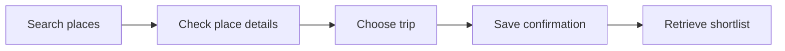

<!--@slide TripMate — make place discovery easier to return to-->
# TripMate — make place discovery easier to return to

A focused travel-planning concept: find a sightseeing place, verify it, save it to a trip, and find it again.

This project explores one clear task rather than a complete travel-booking service.

---

<!--@slide The problem-->
# Keeping a place choice usable

Travelers may discover places while planning, but need a reliable way to verify a place and return to it later.

TripMate focuses on the shortlist task: discover, verify, save, and retrieve.

---

<!--@slide Research and scope-->
# Research gave us a starting point

- The project narrowed from a broad travel-organizing idea to one observable task.
- The current prototype demonstrates a visual click-through.
- It does not represent a validated, full travel service.

---

<!--@slide The core task-->
# One complete task

---

<!--@slide Informal usability signal-->
# Three students completed the available click-through

- 3/3 students completed independently without facilitator help.
- The participants named Rome, Romania, and Vienna.
- One participant's positive overall feedback was recorded; the other two did not have separate recorded comments.

---

<!--@slide Important limitations-->
# What the trial did not validate

- Search results were fixed sample content, not live or destination-specific.
- Task time, detailed clicks, pauses, errors, and confidence were not recorded.
- Three students are a small, non-representative sample.
- The trial does not prove that the design works for all travelers.

---

<!--@slide Design decisions-->
# Refinements focus on clarity and recovery

- Keep the place name and locality together so identity can be checked.
- Confirm which trip received a saved place and offer a clear route to the shortlist.
- Preserve the search query and provide explicit recovery actions for empty and error states.
- Treat accessibility safeguards as design requirements to be tested, not as proven user outcomes.

---

<!--@slide Takeaway and next step-->
# Early completion is promising — deeper testing comes next

TripMate demonstrates a focused place-discovery and shortlist flow. The next step is a more detailed test with destination-appropriate results and recorded observations.

**Presenter:** Hemam Talal Almarashdi  
**Neptun code:** WOFUKB

[Open the Figma presentation](https://www.figma.com/design/4zkXgJJRMEAR3MY3l41qCj/Prototipe?node-id=28-202)
