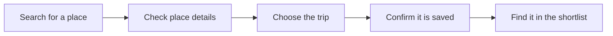

<!--@slide TripMate — Final UX/UI Project-->
# TripMate
## Making sightseeing-place choices easier to save and revisit

**Presenter:** Hemam Talal Almarashdi  
**Neptun code:** WOFUKB  
**Course project:** UX/UI

---

<!--@slide The problem is keeping a choice usable-->
# The problem is keeping a choice usable

Travelers may discover interesting places while preparing a trip, but need a clear way to check which place they found, save it to the right trip, and return to it later.

TripMate focuses on this specific place-discovery and shortlist problem.

---

<!--@slide Research gave us a starting point, not a representative user model-->
# Research gave us a starting point

- An exploratory interview captured one participant's account of preparing a trip to Belgrade with a friend.
- The participant described researching attractions online.
- The early research informed a provisional persona and journey map.
- A desk-based Google Maps audit helped identify opportunities around place identity, saving, and retrieval.

This was an initial exploration. One interview does not represent all travelers.

---

<!--@slide We narrowed the product to one complete, testable task-->
# One focused task

The prototype concentrates on this task. Booking, accommodation, transport, and payments are outside its scope.

---

<!--@slide Three students completed the main task without help-->
# Initial usability check

- Three university students independently completed the available click-through.
- The destinations they named were Rome, Romania, and Vienna.
- All three completed the demonstrated task without facilitator help (3/3).
- One participant's overall feedback was recorded as positive, describing the prototype as enjoyable and easy to understand.

The other two participants did not have separate verbal feedback recorded.

---

<!--@slide We refined the interface around clarity and recovery-->
# Design refinements

- Keep the place name and locality visible together, so users can check the place before saving.
- Show which trip will receive the place.
- Confirm the save and provide a direct route to the shortlist.
- Preserve the search query in the no-results state.
- Provide retry and back actions if saving fails.

These are design decisions documented in the project, not claims that every accessibility or recovery behavior has been validated with users.

---

<!--@slide The prototype demonstrates the whole task — with honest limits-->
# What the prototype demonstrates

- Desktop and mobile search layouts.
- Place details and trip selection.
- Save confirmation and shortlist retrieval.
- No-results and save-failed recovery screens.
- A mini UI guideline, reusable components, iteration notes, and a handoff specification.

The prototype uses fixed sample content. Search is not live, and saving is simulated rather than connected to persistent application storage.

---

<!--@slide The strongest evidence is task completion — the next step is better observation-->
# Takeaway

TripMate presents a focused flow for finding a sightseeing place, checking it, saving it to a trip, and returning to it.

The first click-through suggests that the main task is understandable to the three participants tested. The next step is a broader, more detailed usability test with destination-appropriate results and recorded task time, errors, pauses, and participant feedback.

**Thank you.**

[Open the Figma presentation](https://www.figma.com/design/4zkXgJJRMEAR3MY3l41qCj/Prototipe?node-id=28-202)
